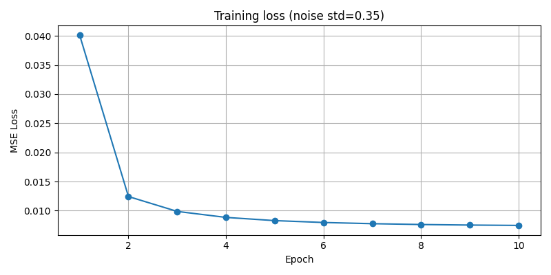
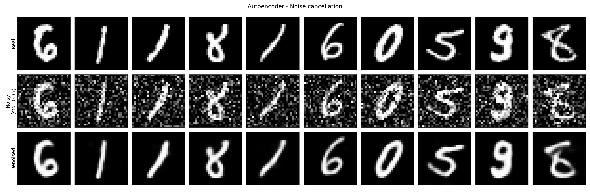

# Práctica 2: Autoencoders

Un **autoencoder** es un tipo de red neuronal utilizada principalmente para tareas de compresión de datos y reducción de dimensionalidad. Su arquitectura consta de dos partes principales:

- **Codificador (Encoder):** comprime los datos de entrada en una representación de menor dimensión, conocida como el espacio latente o embebido.
- **Decodificador (Decoder):** reconstruye los datos originales a partir de esta representación comprimida.

El objetivo principal de un autoencoder es minimizar la diferencia entre los datos de entrada y los datos reconstruidos.

En esta práctica utilizamos un autoencoder para realizar dos tareas:

1. **Eliminación de ruido** (denoising) — [ver sección](#1-eliminación-de-ruido)
2. **Super-resolución** — [ver sección](#2-super-resolution)

## Requisitos e instalación

- Python 3.12
- PyTorch 2.14 (con soporte CUDA opcional, se usa automáticamente si hay GPU)

Desde la raíz del repositorio (`tp2-autoencoders-aa2/`):

```bash
pip install -r requirements.txt
```

---

## 1. Eliminación de ruido

### Idea general

Se añade **ruido gaussiano** a las imágenes de entrada y se entrena el autoencoder para que a partir de la imagen ruidosa reconstruya la **imagen original limpia**. Es decir:

- **Entrada del modelo:** imagen con ruido gaussiano (desviación típica `std = 0.35`)
- **Objetivo de la pérdida:** la imagen original sin ruido
- **Salida del modelo:** la imagen denoised

La pérdida (MSE) se calcula siempre contra la imagen limpia, nunca contra la ruidosa, lo que obliga a la red a "ignorar" el ruido para minimizar el error.

### Arquitectura

Se utiliza el autoencoder convolutivo suministrado en clase (`autoencoder.py`):

- **Encoder:** `Conv2d(1→16, stride 2)` → `Conv2d(16→32, stride 2)` → `Conv2d(32→64, kernel 7)`, con ReLU. Comprime la imagen 28×28 a una representación latente de 64×1×1.
- **Decoder:** `ConvTranspose2d` inversas hasta recuperar 28×28, con `Sigmoid` de salida (valores en [0, 1]).

No se modifica la arquitectura original; solo cambia que la entrada lleva ruido y que el objetivo es la imagen limpia.

### Hiperparámetros

| Parámetro | Valor |
|---|---|
| Ruido gaussiano (std) | 0.35 |
| Épocas | 10 |
| Optimizador | Adam (lr = 1e-3, weight_decay = 1e-5) |
| Función de pérdida | MSE |
| Batch size | 64 |
| Dataset | MNIST (train para entrenar, test para evaluar) |

### Archivos

| Archivo | Descripción |
|---|---|
| `noise.py` | Función `add_gaussian_noise()`: añade ruido gaussiano y recorta a [0, 1] |
| `train_noise.py` | Entrena el autoencoder con entrada ruidosa → objetivo limpio. Guarda los pesos y la curva de pérdida |
| `results_noise.py` | Carga los pesos entrenados y genera la matriz de resultados y las métricas sobre el test set |
| `checkpoints/noise_autoencoder.pt` | Pesos del modelo entrenado |
| `results/loss_curve.png` | Curva de pérdida del entrenamiento |
| `results/noise_cancellation.png` | Matriz de resultados (real / ruido / denoised) |
| `results/metrics.json` | Métricas de entrenamiento y de test |

### Cómo ejecutar

Desde la raíz del repositorio (`tp2-autoencoders-aa2/`):

```bash
# 1. Entrenar el autoencoder (genera checkpoints/ y results/loss_curve.png)
python train_noise.py

# 2. Generar resultados y métricas sobre el test set (genera results/noise_cancellation.png)
python results_noise.py
```

> Nota: la primera ejecución descarga el dataset MNIST automáticamente en `data/`.

### Resultados

**Curva de pérdida** — la loss baja de forma estable durante las 10 épocas (0.0401 → 0.0075):



**Resultados visuales** — matriz de 3 filas: imágenes reales, imágenes con ruido (std = 0.35) y imágenes denoised por el autoencoder (10 primeras imágenes del test set):



**Métricas sobre el test set** (imagen real vs. ruidosa, y imagen real vs. denoised):

| Métrica | Con ruido | Denoised |
|---|---|---|
| MSE (menor = mejor) | 0.0620 | **0.0070** |
| PSNR en dB (mayor = mejor) | 12.08 | **21.57** |

### Conclusiones

- El autoencoder **elimina eficazmente el ruido gaussiano**: el MSE se reduce ~9 veces y el PSNR mejora ~9.5 dB respecto a la imagen ruidosa.
- La mejora se mantiene sobre el **test set**, imágenes nunca vistas durante el entrenamiento, por lo que el modelo generaliza y no solo memoriza.
- El resultado denoised no es idéntico al original: se aprecia un ligero suavizado de los bordes, que es el coste esperado de eliminar el ruido.

---

## 2. Super-resolution

*Sección pendiente de completar.*
