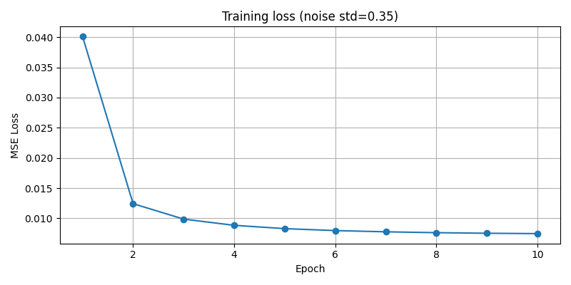
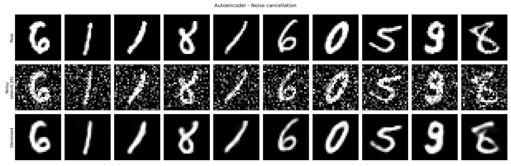
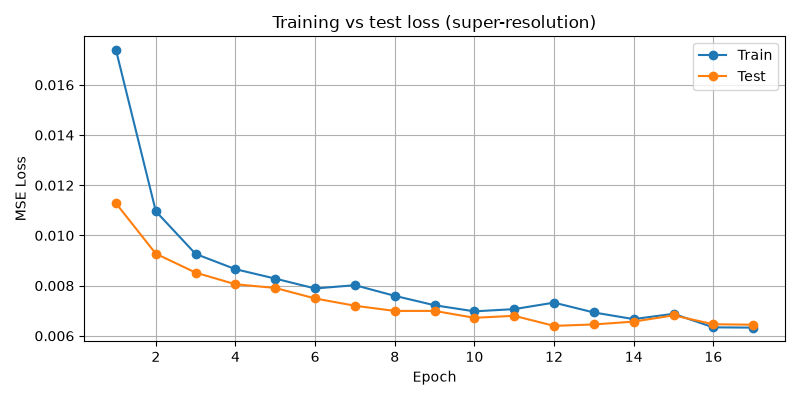
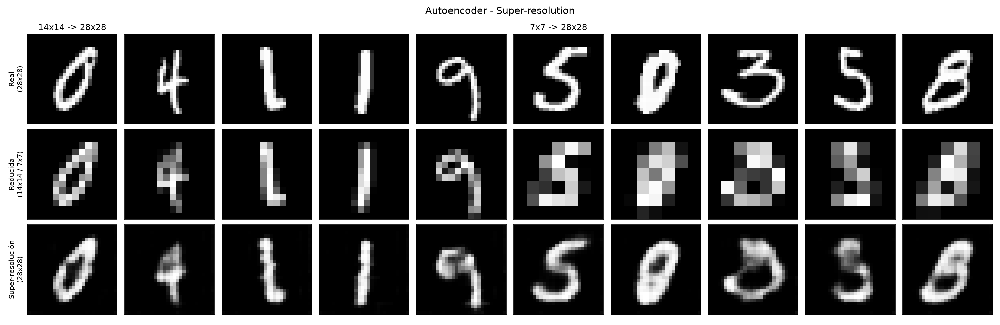

# Práctica 2: Autoencoders

En esta práctica utilizamos un autoencoder para realizar dos tareas:

1. **Eliminación de ruido** (denoising) — [ver sección](#1-eliminación-de-ruido)
2. **Super-resolución** — [ver sección](#2-super-resolution)

## Requisitos e instalación

- Python 3.12
- PyTorch 2.14 (con soporte CUDA opcional, se usa automáticamente si hay GPU)

Desde la raíz del repositorio (`tp2-autoencoders-aa2/`):

```bash
pip install -r requirements.txt
```

---

## 1. Eliminación de ruido

### Idea general

Se añade **ruido gaussiano** a las imágenes de entrada y se entrena el autoencoder para que a partir de la imagen ruidosa reconstruya la **imagen original limpia**. Es decir:

- **Entrada del modelo:** imagen con ruido gaussiano (desviación típica `std = 0.35`)
- **Objetivo de la pérdida:** la imagen original sin ruido
- **Salida del modelo:** la imagen denoised

La pérdida (MSE) se calcula siempre contra la imagen limpia, nunca contra la ruidosa, lo que obliga a la red a "ignorar" el ruido para minimizar el error.

### Arquitectura

Se utiliza el autoencoder convolutivo suministrado en clase (`autoencoder.py`) renombrado a (`noise_autoencoder.py`):

- **Encoder:** `Conv2d(1→16, stride 2)` → `Conv2d(16→32, stride 2)` → `Conv2d(32→64, kernel 7)`, con ReLU. Comprime la imagen 28×28 a una representación latente de 64×1×1.
- **Decoder:** `ConvTranspose2d` inversas hasta recuperar 28×28, con `Sigmoid` de salida (valores en [0, 1]).

No se modifica la arquitectura original; solo cambia que la entrada lleva ruido y que el objetivo es la imagen limpia.

### Hiperparámetros

| Parámetro | Valor |
|---|---|
| Ruido gaussiano (std) | 0.35 |
| Épocas | 10 |
| Optimizador | Adam (lr = 1e-3, weight_decay = 1e-5) |
| Función de pérdida | MSE |
| Batch size | 64 |
| Dataset | MNIST (train para entrenar, test para evaluar) |

### Archivos

| Archivo | Descripción |
|---|---|
| `src/noise.py` | Función `add_gaussian_noise()`: añade ruido gaussiano y recorta a [0, 1] |
| `scripts/train_noise.py` | Entrena el autoencoder con entrada ruidosa → objetivo limpio. Guarda los pesos y la curva de pérdida |
| `scripts/results_noise.py` | Carga los pesos entrenados y genera la matriz de resultados y las métricas sobre el test set |
| `checkpoints/noise_autoencoder.pt` | Pesos del modelo entrenado |
| `results/loss_curve.png` | Curva de pérdida del entrenamiento |
| `results/noise_cancellation.png` | Matriz de resultados (real / ruido / denoised) |
| `results/metrics.json` | Métricas de entrenamiento y de test |

### Cómo ejecutar

Desde la raíz del repositorio (`tp2-autoencoders-aa2/`):

```bash
# 1. Entrenar el autoencoder (genera checkpoints/ y results/loss_curve.png)
python3 -m scripts.train_noise

# 2. Generar resultados y métricas sobre el test set (genera results/noise_cancellation.png)
python3 -m scripts.results_noise
```

> Nota: la primera ejecución descarga el dataset MNIST automáticamente en `data/`. Los comandos usan `-m` y se ejecutan desde la raíz para que Python encuentre el paquete `src/`.

### Resultados

**Curva de pérdida** — la pérdida baja de forma estable durante las 10 épocas (0.0401 → 0.0075):



**Resultados visuales** — matriz de 3 filas: imágenes reales, imágenes con ruido (std = 0.35) y imágenes denoised por el autoencoder (10 primeras imágenes del test set):



**Métricas sobre el conjunto de test** (imagen real vs. ruidosa, y imagen real vs. denoised):

| Métrica | Con ruido | Denoised |
|---|---|---|
| MSE (menor = mejor) | 0.0620 | **0.0070** |
| PSNR en dB (mayor = mejor) | 12.08 | **21.57** |

### Conclusiones

- El autoencoder **elimina eficazmente el ruido gaussiano**: el MSE se reduce ~9 veces y el PSNR mejora ~9.5 dB respecto a la imagen ruidosa.
- La mejora se mantiene sobre el **conjunto de test**, imágenes nunca vistas durante el entrenamiento, por lo que el modelo generaliza y no solo memoriza.
- El resultado sin ruido no es idéntico al original: se aprecia un ligero suavizado de los bordes, que es el coste esperado de eliminar el ruido.

---

## 2. Super-resolution

### Idea general

La super-resolución consiste en **aumentar artificialmente la resolución** de una imagen: el autoencoder recibe una imagen **pequeña** —de **14×14** (factor 2) o **7×7** (factor 4) píxeles, reducida a partir de las de 28×28 con `avg_pool2d`— y debe devolver una imagen de **28×28**. A diferencia de la eliminación de ruido, aquí la información que falta **no está en la entrada**: la red tiene que *inventar* los detalles.

- **Entrada del modelo:** imagen reducida de 14×14 o 7×7 (factor elegido al azar en cada batch).
- **Objetivo de la pérdida:** la imagen **original** de 28×28.
- **Salida del modelo:** la imagen reconstruida a 28×28.

La pérdida (MSE) se calcula siempre contra la imagen original, nunca contra la reducida: si no, la red aprendería a devolver la imagen pequeña, justo lo contrario de lo buscado.

### Arquitectura

El diseño sigue la receta clásica de la literatura (tipo SRCNN): **primero agrandar a lo bruto y después pulir a resolución completa**.

```
Entrada 14×14 / 7×7
   │  F.interpolate(size=(28,28), mode='bilinear')     ← único punto donde cambia el tamaño
   ▼
Lienzo 28×28 (forma aproximada del dígito, suave)
   │  Encoder: Conv2d 1→32→64→64 (kernel 3, padding=1, ReLU)   ← todo a 28×28
   ▼  Decoder: Conv2d 64→64→32→1 (kernel 3, padding=1) + Sigmoid
Salida 28×28 en [0,1]
```

- **`F.interpolate`** redimensiona la imagen pequeña a un lienzo de 28×28 interpolando entre píxeles vecinos. No inventa información (por eso sale suave), pero sitúa la forma del dígito en su posición correcta.
- **Encoder/decoder:** seis convoluciones con `padding=1` que **conservan el tamaño** (28→28): extraen rasgos (1→32→64 canales) y los convierten en el gris final de cada píxel (64→32→1). Cada píxel de salida se calcula de una ventana local de 3×3, lo que permite **afilar bordes** en vez de estirar bloques.
- **`downsample(images, factor)`** (en `src/superresolution.py`) reduce las imágenes con `avg_pool2d`: factor 2 → 14×14, factor 4 → 7×7.

### Hiperparámetros

| Parámetro | Valor |
|---|---|
| Reducción | factor aleatorio por batch: 2 (→14×14) o 4 (→7×7) |
| Épocas | techo 40 con **early stopping** (paciencia 5): paró en la 17, mejor modelo en la **12** |
| Optimizador | Adam (lr = 1e-3, weight_decay = 1e-5) |
| Función de pérdida | MSE |
| Batch size | 64 |
| Validación | conjunto de test completo (con los dos factores) al final de cada época |
| Dataset | MNIST (train para entrenar, test para validar y evaluar) |

### Archivos

| Archivo | Descripción |
|---|---|
| `src/resolution_autoencoder.py` | Clase del modelo (interpolate + encoder/decoder) y función `downsample()` |
| `scripts/train_superres.py` | Entrenamiento con validación por época y early stopping; guarda el mejor modelo y la curva |
| `scripts/results_superres.py` | Carga el mejor modelo y genera la matriz de resultados y las métricas sobre el test |
| `checkpoints/resolution_autoencoder.pt` | Mejor modelo (época 12) |
| `results/loss_curve_superres.png` | Curva de pérdida train vs test |
| `results/superresolution.png` | Matriz de resultados (real / reducida / generada) |
| `results/metrics_superres.json` | Métricas de entrenamiento, validación y test |

### Cómo ejecutar

Desde la raíz del repositorio (`tp2-autoencoders-aa2/`):

```bash
# 1. Entrenar (genera checkpoints/ y results/loss_curve_superres.png)
python3 -m scripts.train_superres

# 2. Generar resultados y métricas sobre el test set (genera results/superresolution.png)
python3 -m scripts.results_superres
```

> Nota: la primera ejecución descarga el dataset MNIST automáticamente en `data/`.

### Resultados

**Curva de pérdida (train vs test)** — ambas curvas bajan juntas y se estancan hacia la época 12; el early stopping cortó en la 17. El test **nunca sube** mientras el train baja → **no hay sobreajuste**:



**Matriz de resultados** — 3 filas × 10 columnas: imágenes reales (28×28), imágenes reducidas **a escala real** (14×14 al 50% y 7×7 al 25% del hueco) y las imágenes generadas por el autoencoder. Las 5 primeras columnas usan entrada de 14×14 y las 5 últimas de 7×7:



**Métricas sobre el conjunto de test** (comparando con ampliar la imagen reducida *a lo bruto* con interpolación nearest):

| Métrica | 14×14 (bruto → red) | 7×7 (bruto → red) |
|---|---|---|
| MSE (menor = mejor) | 0.0157 → **0.0020** | 0.0371 → **0.0089** |
| PSNR en dB (mayor = mejor) | 18.03 → **26.96** | 14.30 → **20.52** |

### Conclusiones

- La super-resolución con 14×14 es casi perfecta (**+8.9 dB** sobre ampliar a lo bruto): 196 píxeles conservan la forma del dígito y la red solo tiene que afilar los bordes.
- Con 7×7 la mejora sigue siendo clara (**+6.2 dB**), pero aparece el **límite de la información**: con solo 49 píxeles, algunos dígitos reducidos son ilegibles ni siquiera para un humano (el 4 de la matriz), y la red *adivina* la forma más plausible. No se puede recuperar lo que la entrada ya no contiene.
- El **early stopping** confirmó la intuición de que sobraban épocas (paró en la 17 con un techo de 40), y la curva train/test demostró la **ausencia de sobreajuste**: las dos descienden juntas y el test nunca se deteriora.
- El MSE tiende a producir bordes suaves: cuando la red duda entre dos formas posibles, predecir la media le sale más barato que arriesgar una forma concreta. Es un comportamiento conocido de la super-resolución optimizada con MSE.
